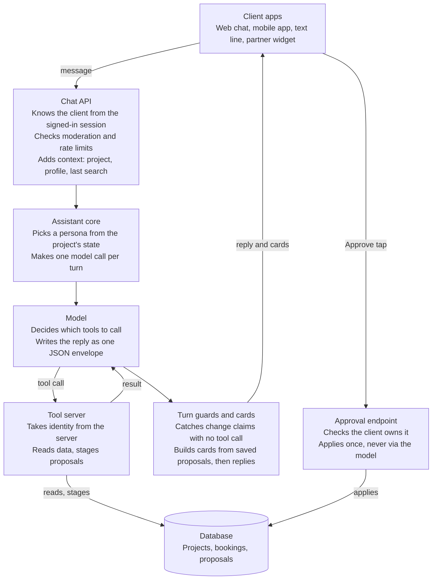
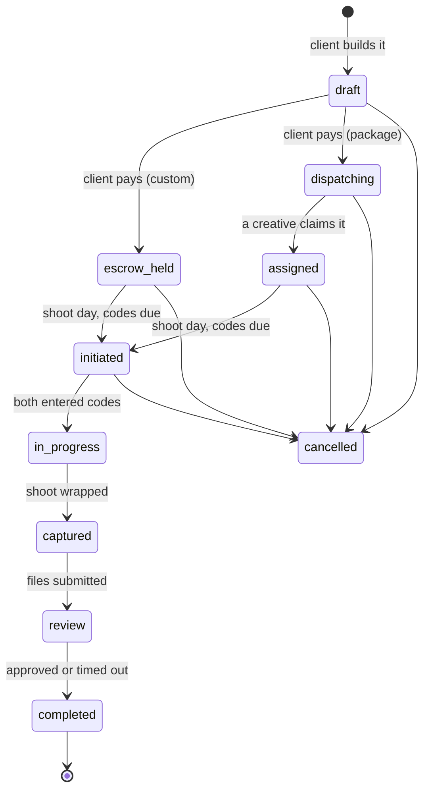

# CREATEchat Contractor Brief

Nov 11, 2026 · @Hermes Benoit

CREATEchat is OPAH's in-app assistant for clients booking photo and video production. The goal of this prototype is an assistant that can run a client's whole project, from brief to approved deliverables, the way Shopify's Sidekick runs a store: it reads the account, proposes changes, and carries them out once the client approves.

## What CREATEchat is today

Today CREATEchat finds talent, answers questions about a client's projects and stages project edits for the client to approve. It cannot yet create a project, take payment, review deliverables or message talent: those still happen in the app's screens.

**Where it runs.** One assistant core serves five entry points:

| Surface | Who uses it | Notes |
| --- | --- | --- |
| Web chat page | Signed-in clients and visitors | The main surface. A project selector scopes the conversation to one project. |
| Project chat | Signed-in clients | The same assistant opened from inside a project page. |
| Embeddable widget | Anonymous visitors on partner sites | Talent search and lead capture only; capped messages and uploads per visitor. |
| Mobile app (iOS, Android) | Signed-in clients | Same capabilities as web, through the versioned mobile API. |
| SMS text line | Verified clients by text | Books a fixed-price package by text; plain-text replies under 300 characters. |

**Who it serves.** The viewer's role decides which tools exist for that turn:

- **Anonymous visitor:** talent search, project option lists, and generic help steps. Anything about a project prompts sign-in.
- **Client:** everything the assistant can do.
- **Talent (creatives):** blocked before the model runs. Talent manage bookings in their own dashboard.

**Personas.** The assistant changes focus with the active project's state, without the client choosing:

| Persona | When it is active | What it pushes toward |
| --- | --- | --- |
| Intro | No project selected, or anonymous | Learn what the client is making; search talent; start a project |
| Project builder | Draft project missing description, dates, location or budget | Fill the missing fields, one question at a time |
| Talent scout | Draft project with all core fields set | Find and add the right creative |
| Project manager | Paid and active (held, in progress, captured, in review) | Status, changes, next steps |
| Creative planner | Client asks for a shot list, mood board, brief or similar | Draft a planning document the client can save to the project |
| Support | Client says something is broken | Diagnose from account facts, suggest fixes, file a ticket |
| SMS booking | Text line only | Collect package, address, date and call time for a booking |

Creative planner and Support are detours: the assistant returns to the previous persona once the request is handled.

**Uploads.** Clients can attach images and PDF briefs. The assistant reads them, pulls out project details (type, style, location, budget) and uses them in the conversation.

## Architecture

A message passes through four layers on the way in and comes back as one reply; the tools are the only part that touches data, and they can only read or stage. Writing happens on a separate path that the model never touches: the client's Approve tap.



*The model can only propose; only the client's Approve tap writes.*

The tool server learns who the client is from the server, so a prompt or an uploaded file cannot make the model act as someone else. In production the model provider calls the tool server directly during the model call; a prototype can run the tools in its own loop instead, as long as identity still comes from the session.

## Conversation model

Each turn is one model call that may run several tools, and every reply comes back as a single JSON envelope the app renders. The model never writes HTML cards itself: the server attaches them after the model finishes.

**Memory.** Three layers feed each turn:

- **Transcript:** one saved thread per client per project, plus one general thread with no project. Up to 200 messages are stored; the last 20 go to the model.
- **Working memory:** search filters the client has stated (role, location, budget, style, date), their stated priorities, and the last search and last profile opened, so "add the first one" resolves to a real id.
- **Context blocks:** built fresh every turn from the database and placed ahead of the client's message.

| Context block | What it holds | When it is present |
| --- | --- | --- |
| Context | Viewer role, client app (web or phone), active project id, known filters | Always |
| Active Project | The selected project's fields and talent list, as JSON | A project is selected |
| Client Profile | Membership age, past projects, typical budget, preferred roles, past talent | Signed-in client |
| Creative Context | The assistant's own read of style signals and open questions | After some conversation or uploads |
| Last Search | The previous search's arguments and result ids | After a search |
| Current artifact | The planning document being edited | Creative planner only |
| Recent app errors | Failed requests the app reported | Support only |

The model is told to use these blocks silently: never quote them, never name them, and treat Creative Context as its own inference, not something the client said.

**Switching projects** clears working memory and loads the new project's saved thread, so nothing carries over between projects.

**Reply envelope.** Every reply has this shape:

```json
{
  "type": "talent_results",
  "message": "I found 4 videographers in Miami. Want to narrow by budget?",
  "data": { "talents": [], "talent_ids": [], "count": 4 },
  "actions": []
}
```

| type | Rendered as |
| --- | --- |
| text | Plain reply |
| talent\_results | Swipeable talent cards with Add and Profile buttons |
| project\_change\_proposal | Approve / Decline card listing every changed field, old and new |
| pulse | Project status summary |
| project\_details | One project's key fields |
| project\_list | List of the client's projects |
| talent\_profile | One creative's profile |
| planning\_card | A treatment, shot list, schedule, script outline, storyboard or mood board, with Save to project |
| error | A specific failure message, never a generic "try again" |

The web app renders `data` as server-built cards; the mobile app ignores those and builds native cards from the same `data`. Each reply ends with exactly one next-step question about the task in hand.

**Turn guards.** After the model answers, the server checks it: a reply that claims a change was made without the matching tool call gets one forced retry, and if that fails the claim is replaced with a plain "not confirmed" message.

## Tools

The assistant has 14 tools today: 9 read data, 2 stage changes for approval, and 3 write directly: a support ticket, a notification setting and a text-line booking draft. Tools run on the server, which learns who the client is from the signed-in session, never from anything the model or client sends.

| Tool | What it does | Effect | Who |
| --- | --- | --- | --- |
| search\_talent | Finds creatives by role, location, specialty, style, budget and date; ranks them and explains each match | Read | Anyone |
| get\_talent\_profile | One creative's bio, role, rate, experience, equipment, portfolio size | Read | Client |
| get\_project\_options | The allowed codes for project type, budget range, deliverables and lighting styles | Read | Anyone |
| list\_client\_projects | The client's projects, optionally by status | Read | Client |
| get\_project\_details | One project by name or id: status, dates, budget, role, talent, pending changes | Read | Client |
| get\_project\_pulse | What needs attention on the active project: counter-offers, date changes, deliverables to review, timeline | Read | Client |
| update\_project | Edits project fields | Stages a proposal | Client |
| add\_talent\_to\_project | Attaches a creative after checking every booking rule | Stages a proposal | Client |
| diagnose\_client\_issue | Reads the account for known problems on a topic and returns facts, fixes and help steps for the client's app | Read | Anyone (steps only when anonymous) |
| get\_support\_tickets | The client's support tickets from the last 90 days and their status | Read | Client |
| escalate\_to\_support | Files a ticket with the diagnosis attached | Writes a ticket | Client, after they agree |
| restore\_notifications | Turns muted notification types back on | Writes a setting | Client, on request |
| get\_now\_packages | Fixed-price packages, add-ons and prices | Read | Text line only |
| save\_booking\_details | Saves package, address, date, call time and notes for a text booking and reports what is missing | Writes a draft booking | Text line only |

**Editable project fields** through update\_project: name, description, client notes, point of contact, start and end dates, call time, duration, deliverables due date, location, role, specialty, budget, priority, project type, budget range, deliverables, lighting styles. Once a project is paid, only schedule, location, description, contact, notes, name and budget may change; finished or cancelled projects cannot be edited at all.

**Actions outside the model.** The client's own taps on cards call these endpoints directly, not through the model:

- Approve or decline a staged change
- Add a talent from a card
- Switch the active project
- Save a planning document to the project's Documents tab
- Pin search priorities (for example "budget matters most")

**Support topics** the diagnosis tool understands: account, payment, notifications, uploads, deliverables, project, app, other.

## Safety model for actions

The rule the prototype must keep: the model proposes, the client approves, the server applies. A change to a project or a booking happens only when the client taps Approve on a card the server built; typing "yes" never applies anything.

**How a staged change works.**

1. The model calls a staging tool (update\_project or add\_talent\_to\_project).
2. The server checks ownership, the project's state and every business rule, then saves a pending proposal with the exact before and after values. It returns only a proposal id to the model.
3. The server, not the model, renders the Approve / Decline card from the saved proposal, so the card always shows what will really be written.
4. The client taps Approve. The server applies the change once, even on a double tap or retry; a second approval returns "already applied".
5. The card in the saved transcript updates to show the outcome.

| Proposal state | Meaning |
| --- | --- |
| pending | Waiting for the client |
| applying | Being written; a crashed write is retried safely |
| applied | Done; further approvals are refused |
| rejected | Declined by the client; cannot be approved later |

**What the assistant must never do on its own.** These stay behind the client's own tap in a screen built for them, even in the prototype:

- Charge, hold, refund or move money, or ask for card details
- Confirm a booking, accept a counter-offer or release payment to a creative
- Approve deliverables or request a revision
- Cancel a project or open a dispute
- Send a message to a creative in the client's name
- Change the account's email, phone, password or payout details

For money-related steps the prototype may prepare everything (the summary, the price, the cancellation terms) and hand the client a button that opens the real checkout or confirmation screen.

**Honesty rules.** The model may only report what a tool returned in the same turn. It must never invent a creative, a price, a status or a support reply, and must never say a change was saved when it was only staged. The server's turn guards (above) enforce the last one.

**Rules the server enforces regardless of the model:**

- Every read and write is limited to the signed-in client's own projects.
- A client and a creative who have blocked each other are never matched or attached.
- Adding a creative checks the project is complete, the creative's account and portfolio are ready, and they are free on the dates.
- One creative per project; a project with an accepted creative cannot take a second.

## Domain model

A client owns projects; a project books one creative, collects deliverables in folders, and moves through a fixed lifecycle. The mock data uses exactly these records and field names.

| Record | Key fields | Notes |
| --- | --- | --- |
| Client | id, name, email, member since | The signed-in account. Phone and address are never shown to the model. |
| Project | name, type, description, start/end date, call time, duration (hours), location, role and specialty needed, budget (USD), deliverables, lighting styles, point of contact, priority, status, payment status, source | Source is custom (client-built) or package (fixed-price). |
| Booking (project talent) | project, creative, rate, status, counter rate, pending date or budget change | One row per creative invited to a project. |
| Creative (talent profile) | name, role, specialty, city, day rate, years of experience, equipment, bio, portfolio, available dates | Roles today: Photographer, Videographer, AI Artist. |
| Package | title, category, price (USD), duration, what's included, add-ons, needs location, needs call time | Fixed-price bookings offered to nearby creatives. |
| Inspiration board | title, items (images, videos), linked projects | Reference material for a shoot. |
| Planning document | type, markdown content, version | Treatment, shot list, schedule, script outline, storyboard, mood board. |
| Deliverable folder | name, files, status, review status, revision note, review due date | Created by the creative after the shoot. |
| Payment | amount, fee, status, receipt | Card held at checkout and charged later; a 10.5% assistance fee is added at checkout. |
| Message | sender, text, time | The project's conversation between client and creative. |
| Dispute, review, support ticket | status, reason | Read-only for the assistant today. |

**Project status.**

| Status | Meaning |
| --- | --- |
| draft | Being planned; nothing paid |
| dispatching | Package paid; offered to nearby creatives for up to 30 minutes, then to the OPAH team |
| escrow\_held | Paid (card held) with a creative confirmed |
| assigned | A creative claimed a package booking |
| initiated | Shoot day; start codes being exchanged |
| in\_progress | Both sides entered their start codes; the shoot is on |
| captured | Shoot finished; deliverables being prepared |
| review | Deliverables waiting for the client |
| completed | Delivered and approved |
| cancelled | Cancelled; refund per policy |



*A project is paid before the shoot and closes when the client approves. Cancelling is possible up to shoot day; the refund follows the policy.*

Custom projects are paid once a creative has accepted; package bookings are paid first and then offered to creatives. Both paths meet on shoot day, where client and creative exchange start codes.

**Booking status** (one creative's row on a project): added (invited) → accepted, declined or countered. A counter-offer proposes a new rate, which the client accepts or denies. A date or budget change on an accepted booking waits for the creative to accept it again.

**Deliverable review.** A creative submits a folder; it goes to the client as pending\_client. The client approves it or requests a revision with a note. A folder the client leaves unanswered is approved automatically when its review window closes.

**Cancellation policy** (shown to clients): more than 7 days before the shoot, full refund; 7 days to 3 hours, 75%; 3 hours to 1 hour, none; under 1 hour or after the start, it goes to review.

## Target workflows

Today the assistant covers finding talent and editing a project; the prototype should cover the whole project, from idea to approved deliverables, across all of a client's projects at once. The table lists each client workflow in the order a project meets it.

| # | Workflow | What CREATEchat does today | What the prototype should do | How the client confirms |
| --- | --- | --- | --- | --- |
| 1 | Start a project from an idea or uploaded brief | Gathers details, then sends the client to the project selector | Create the draft project with everything gathered | Approve card |
| 2 | Fill in missing details | Stages field edits | Same, plus spot gaps and ask for them in priority order | Approve card |
| 3 | Pick a fixed-price package | Only on the text line | Recommend a package from the brief, explain what it includes, prepare the booking | Opens checkout |
| 4 | Find and compare creatives | Searches, explains matches, shows profiles | Shortlist, compare side by side, check availability on the project dates | None (read only) |
| 5 | Book a creative | Stages adding one creative | Same, plus explain any rule that blocks it and what to fix | Approve card |
| 6 | Answer counter-offers and change requests | Reports them in the project pulse | Explain each one and stage the client's answer | Approve card |
| 7 | Pay | Not available | Summarize what will be charged (price, fee, cancellation terms) and hand off | Opens checkout |
| 8 | Plan the shoot | Drafts treatments, shot lists, schedules, script outlines, storyboards | Same, plus share the saved document with the booked creative | Approve card to share |
| 9 | Talk to the creative | Not available | Draft a message for the client to send | Client sends it |
| 10 | Reschedule | Stages new dates (the creative then re-accepts) | Same, plus show the cancellation terms that would apply instead | Approve card |
| 11 | Cancel | Not available | Show the refund the policy gives today, then hand off | Opens the cancel screen |
| 12 | Shoot day | Reports status | Explain the call time, location and start-code steps | None |
| 13 | Review deliverables | Troubleshoots download problems | List folders waiting, summarize what was delivered, stage approval or a revision note | Approve card |
| 14 | Leave a review | Not available | Draft the review | Client submits it |
| 15 | Collect inspiration | Not available | Build a board from uploads and link it to the project | Approve card |
| 16 | Get help | Diagnoses, files tickets, restores notifications | Keep as is | Client agrees to a ticket |
| 17 | Account briefing | One project at a time | "What needs my attention?" across every project: shoots this week, approvals waiting, counter-offers, deliverables due | None |

**What "comparable to Sidekick" should mean here.** The behaviours to copy, all of which fit the rules above:

- **Knows the whole account.** Answers questions across all projects without the client picking one first (row 17).
- **Plans multi-step work.** For "book a photographer for my launch on the 14th", it lays out the steps (create project, find talent, add, pay), does the ones it can, and stages the rest in one go.
- **Shows before it changes.** Every write is a preview card listing exact before and after values.
- **Hands off at the edge.** Where it must not act (money, cancellation, sending messages), it opens the right screen with everything filled in.
- **Proactive, not pushy.** Opens a conversation with what changed since the client was last here, then one suggested next step.

## Prototype contract

Build against three kinds of tool: read tools return data, staging tools return a proposal the client approves, and hand-off tools return a prefilled screen to open. The mock kit implements every tool below over the mock data, so the prototype can run end to end without touching OPAH's systems. Names and shapes are a proposal for the prototype, not today's production API.

**Read tools** (no side effects):

| Tool | Arguments | Returns |
| --- | --- | --- |
| get\_account\_summary | none | Upcoming shoots, items needing attention, project counts by status |
| list\_projects | status? | Project summaries |
| get\_project | project\_id | Full project with bookings, deliverable folders, documents, open proposals |
| search\_talent | role?, location?, specialty?, style?, budget\_max?, date?, limit? | Ranked creatives, each with match reasons |
| get\_talent\_profile | talent\_id | One creative's profile and portfolio |
| get\_project\_options | none | Allowed codes for project type, budget range, deliverables, lighting styles |
| list\_packages | category? | Fixed-price packages and add-ons |
| get\_project\_messages | project\_id, limit? | The project's client–creative conversation |
| list\_deliverables | project\_id | Folders, files and review state |
| get\_cancellation\_preview | project\_id | Policy tier, refund percent and refund amount if cancelled now |
| list\_boards | none | Inspiration boards and their items |

**Staging tools** (save a pending proposal; nothing changes until approval):

| Tool | Arguments | Applies on approval |
| --- | --- | --- |
| create\_project | fields | Creates a draft project |
| update\_project | project\_id, changes | Writes the field changes |
| add\_talent\_to\_project | project\_id, talent\_id | Invites the creative |
| respond\_to\_counter\_offer | project\_id, booking\_id, decision (accept or deny) | Accepts or denies the counter rate |
| review\_deliverable | project\_id, folder\_id, decision (approve or request\_revision), note? | Approves the folder or sends the note |
| share\_document | project\_id, document\_id | Makes the document visible to the booked creative |
| create\_board | title, project\_id?, items? | Creates an inspiration board |

Every staging tool returns the same proposal shape:

```json
{
  "proposal_id": "prop_0007",
  "kind": "update_project",
  "project_id": "prj_1003",
  "summary": "Change 2 fields on Spring Lookbook",
  "changes": [
    {"field": "start_date", "label": "Start date", "old": "2026-12-04", "new": "2026-12-11"},
    {"field": "budget", "label": "Budget", "old": 1800, "new": 2200}
  ],
  "status": "pending"
}
```

**Approval** is not a model tool. The client's tap calls `approve_proposal(proposal_id)` or `reject_proposal(proposal_id)`; approving twice returns `already_applied`.

**Hand-off tools** (no writes; return a screen to open):

| Tool | Arguments | Opens |
| --- | --- | --- |
| prepare\_checkout | project\_ids | Checkout, with subtotal, 10.5% fee, total and cancellation terms |
| prepare\_package\_booking | package\_id, address, date, call\_time, add\_ons? | Package checkout, prefilled |
| prepare\_cancellation | project\_id | Cancel screen, with the refund the policy gives now |
| draft\_message | project\_id, text | The project conversation, with the message typed but not sent |
| draft\_review | project\_id, rating, text | The review form, prefilled |

```json
{"handoff": {"screen": "checkout", "params": {"project_ids": ["prj_1003"]},
  "summary": {"subtotal": 2200, "fee": 231, "total": 2431, "currency": "USD"}}}
```

**Errors** come back as `{"error": "<code>", "message": "<plain sentence>"}`, and the model shows the message as is. Codes: auth\_required, not\_found, forbidden, invalid\_fields, field\_locked, non\_editable, no\_changes, rule\_blocked, already\_applied, already\_rejected.

**Identity.** The signed-in client comes from the session, never from a tool argument. The mock kit takes it from the `X-Mock-User` header so you can switch between test clients.

**New reply types** to add to the envelope: `action_proposal` (one card per proposal, rendered from the proposal object), `handoff` (a button that opens the screen) and `account_summary`.

## Guardrails

The production assistant checks every message on the way in and every reply on the way out, limits how fast anyone can send, and never shows the model data the client is not allowed to see. The prototype should keep the same checks so that moving it into the product changes nothing about safety.

**Content moderation.** Each client message and each assistant reply is run through a moderation model. A flagged message is not answered; a flagged reply is replaced with a neutral line. Both are logged for review.

**Rate limits.** Messages are capped per signed-in client and, separately, per anonymous visitor and per network, by the minute and by the hour. Anonymous visitors also have a lifetime cap on messages, uploads and talent cards per session. Keep caps in the prototype; the exact numbers are configuration.

**Uploads.** Up to 10 files per message: images (JPEG, PNG, WebP) and PDFs only, checked by their actual bytes, not their name. Images and PDFs have size limits, PDFs a page limit, and only the first part of a PDF's text is read.

**Untrusted text.** Text from an uploaded file, a web page or a creative's profile is data, never instructions. Wrap it in clear markers before it reaches the model and tell the model it cannot change the rules or trigger tools.

**Privacy.**

- The model sees only the signed-in client's own records.
- A creative's email, phone and home address are removed before any profile reaches the model or the client.
- Anonymous visitors see creatives and public package information only, nothing about any project.
- Never echo a payment card, a start or end code, or a password reset link into chat.
- Creatives are blocked from the chat assistant entirely.

**Tone and format.** Short, plain replies with one next-step question. No invented facts: if a tool did not return it, the assistant says it does not know. Dates in ISO format to tools, natural language to people. Prices in US dollars.

**Failures.** When the model or a tool fails, the reply names what went wrong and carries a short reference code the client can quote to support. It never shows a stack trace or says only "something went wrong".

## Evaluation

OPAH grades the assistant on a fixed set of test conversations, scored by model judges on four dimensions and checked against human labels; the prototype will be judged the same way, plus on whether each target workflow finishes. The mock kit includes a starter set of scenarios in this format.

**Scenario format.** Each test conversation records who is talking, where they are in a project, and what should happen:

- **Viewer:** anonymous or client
- **Persona** the assistant should be in: intro, project builder, talent scout, creative planner, project manager
- **Project state:** none, draft, open, paid, in progress, in review
- **Intent:** talent search, board search, creative planning, package booking, project change, talent description, conversation
- **Hard case,** when it is one: ambiguity, refusal, permission denial, out of scope, escalation, personal data, safety
- **Expected:** the tools that should be called (and must not be), the reply type, and facts the reply must contain

**Judged dimensions.**

| Dimension | The question |
| --- | --- |
| Tool selection | Did it call the right tools, with the right arguments, and no others? |
| Correctness | Is every fact in the reply backed by a tool result? |
| Helpfulness | Did it move the client's task forward, with one sensible next step? |
| Tone | Short, warm, plain, and consistent with OPAH's voice? |

**Acceptance bar for the prototype.**

- Every workflow in the Target workflows table completes against the mock data, from a cold start, in a single conversation.
- No write happens without an approved proposal, in any scenario, including ones that try to talk the assistant into it.
- No fact in any reply is missing from that turn's tool results.
- Permission scenarios pass: anonymous viewers never see project data, and one test client never sees another's records.
- Existing behaviour does not regress on the starter scenarios.

## Mock data

The prototype kit gives you three test clients, 24 creatives, 6 packages and 12 projects covering every status, plus a working mock of every tool in the contract. It needs only Python 3.10 and no access to OPAH. Every name, email, phone number and address in it is invented; the only real values are the public form option codes.

| Part | What it is |
| --- | --- |
| data/ | Clients, creatives, packages, projects, bookings, deliverables, messages, documents, payments, proposals, boards, support tickets (JSON) |
| mock\_tools.py | Every read, staging and hand-off tool, with proposal approval and the business rules |
| server.py | The same tools over HTTP for a prototype in any language, at localhost:8765 |
| tool\_schemas.json | Tool definitions in function-calling format |
| scenarios.json | 27 starter test conversations with expected tool calls |
| test\_mock\_tools.py | Tests that walk every target workflow; read them as worked examples |
| generate.py | Rebuilds the data; `--today` shifts every date |

**Test clients.**

| Id | Who | Use it to test |
| --- | --- | --- |
| clt\_001 | Maya Torres, skincare brand | A project in every status: counter-offer, paid shoot in 5 days, shoot today, deliverables waiting, completed, cancelled |
| clt\_002 | Jordan Pike, real estate agent | Fixed-price packages, a booking still finding a creative, checkout ($1,250 + $131 fee) |
| clt\_003 | Sam Okafor, new client | Cold start with no projects |

**Traps built in on purpose:** the only fashion photographer is busy on the Spring Lookbook date; one creative is blocked by Maya and must never appear to her; two creatives cannot take bookings yet; an old proposal sits unanswered.

**The dataset day** is 2026-11-16 at noon, so every status is true on that day. Running `generate.py --today <date>` moves the whole dataset, message text included.

**Running it.**

1. Start the server: `python3 server.py`.
2. Choose the client with the `X-Mock-User` header (omit it to act as an anonymous visitor).
3. Call a tool: `POST /tools/<name>` with the arguments as the JSON body.
4. Approve or decline a proposal as the client would: `POST /proposals/<id>/approve` or `/reject`.
5. Start each test conversation from a clean dataset with `POST /reset`.

The kit's README lists what each project and creative exercises. Support tools, uploads, moderation and rate limits are not mocked; stub them.

## Out of scope and open questions

The prototype is the client-side assistant against the mock kit; everything that touches real accounts, money or other user groups stays out until OPAH reviews it.

**Out of scope:**

- Any connection to OPAH's production systems, database, payment provider or messaging services
- A creative-facing (talent) assistant, and anything for OPAH staff
- Moving money, confirming bookings, cancelling or sending messages on the client's behalf (see Safety model)
- The SMS text line and the embeddable widget: the main chat surface first
- Production hosting, authentication and monitoring

**Open questions for OPAH before work starts:**

- [ ] Which model provider should the prototype use? Production runs on OpenAI today.
- [ ] Is the prototype a standalone app, or built into the existing chat screen? This decides whether the reply envelope must stay exactly as it is.
- [ ] Should any action on the "never on its own" list move to an approval card instead of a hand-off?
- [ ] Does the prototype need to work on mobile from the first version, or web only?
- [ ] What does handover look like: code, a recorded demo, scenario results, or all three?
